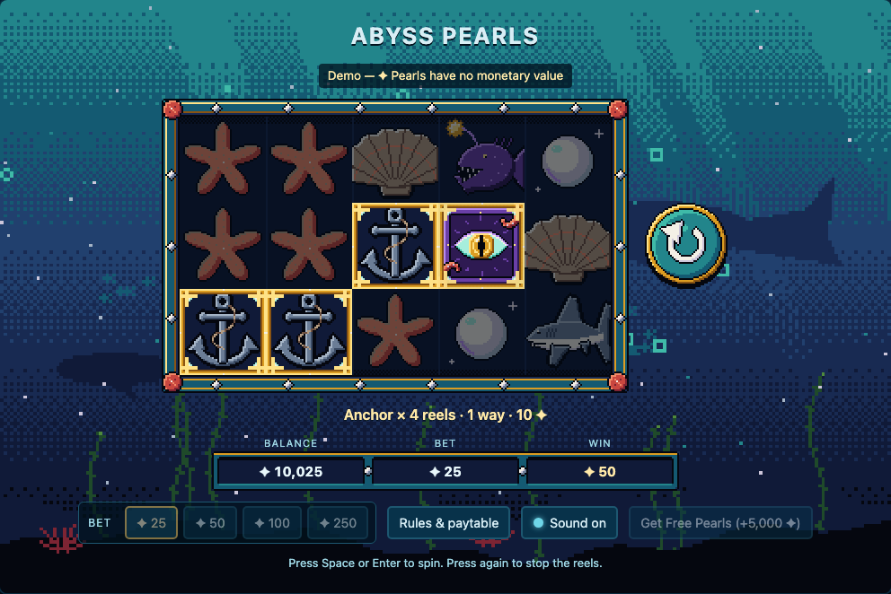
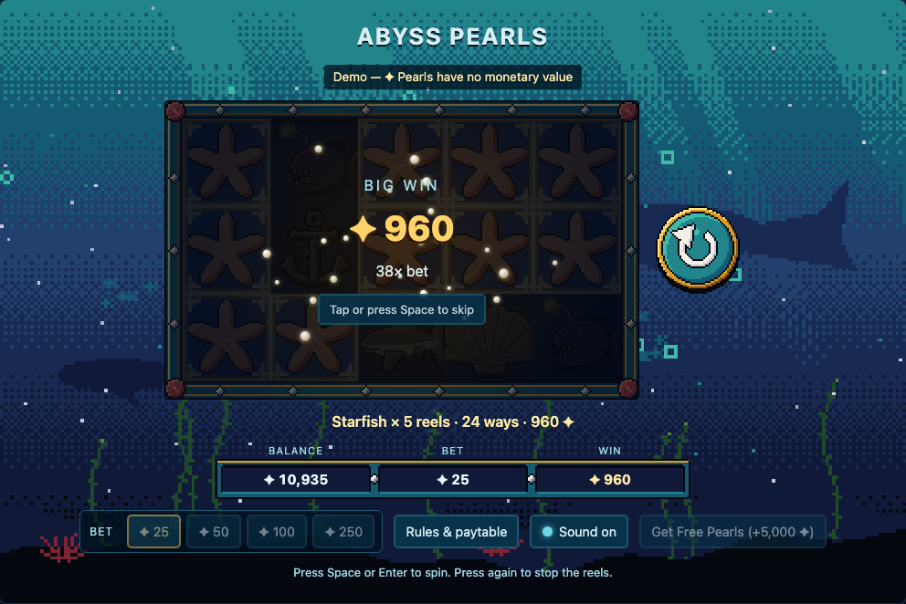
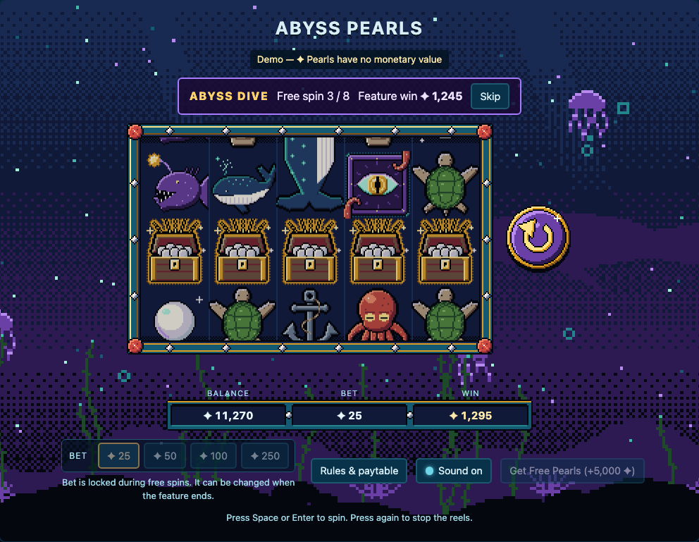
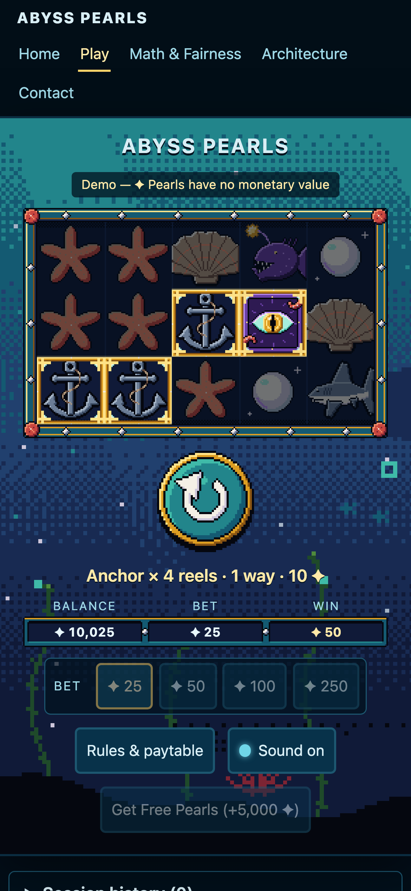
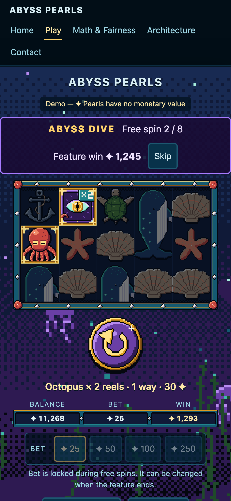

# Abyss Pearls

An original deep-sea video slot: 5 reels × 3 rows, **243 ways to win**, a stacked Whale
hero symbol, a Kraken Eye wild and Treasure Chest scatters that start the **Abyss Dive**
free spins, where every wild lands with a ×2 or ×3 multiplier.

It is a portfolio piece for studios and licensed operators: it shows the math, the
feel and the architecture of a slot, end to end, running entirely in the browser.

> **Demo only. ✦ Pearls have no monetary value.** They cannot be bought, sold,
> transferred or cashed out. There is no payment, banking or wallet integration of any
> kind; the only top-up is a "Get Free Pearls" button when the balance runs low.



## Headline numbers

RTP, its 95% confidence interval, hit frequency, volatility, feature trigger rate, win
cap and the full win distribution are **not repeated here**. They live in one place:

- the **Math & Fairness** page of the running site (`/math`), and
- [`reports/rtp-report.json`](reports/rtp-report.json), which that page reads at build time.

The report is produced by `npm run sim` (exact base-game RTP over every reel-stop
combination plus a stratified simulation of the feature) and carries math and code
hashes so anyone can regenerate it and compare. Design notes are in
[`docs/MATH.md`](docs/MATH.md).

## Screenshots

| | |
|---|---|
|  |  |
| Big win celebration (tap or Space to skip) | Abyss Dive free spins with wild multipliers |
|  |  |
| Phone layout, 390 px (DPR 3) | Free spins on a phone |

More in [`docs/screens/`](docs/screens/): home, math, architecture, contact, rules
dialog, and the mobile portfolio pages.

## Run it

Requires a current Node.js LTS (and, only for regenerating art, Python 3 with Pillow).

```sh
npm install
npm run dev          # http://localhost:5173
```

| Command | What it does |
|---|---|
| `npm run dev` | Dev server on `localhost:5173` |
| `npm run lint` | ESLint, including the MVC layer rules |
| `npm run test` | Vitest unit tests (models, controllers, report view model) |
| `npm run e2e` | Playwright smoke tests against the dev server (reuses a running one) |
| `npm run e2e:prod` | Builds, serves `dist/` with `vite preview` on port 4173, runs the smoke suite against it |
| `npm run sim` | Re-runs the RTP simulation and rewrites `reports/rtp-report.json` |
| `npm run art` | Regenerates every PNG in `src/assets/` from `tools/art/` |
| `npm run build` | Type-checks and builds the production bundle into `dist/` |
| `npm run preview` | Serves the production build on `localhost:4173` (deep links work) |

**Art:** the generators need Pillow in the project virtualenv:

```sh
python3 -m venv .venv
.venv/bin/pip install Pillow
npm run art
```

**Screenshots:** `SCREENSHOTS=1 npx playwright test screens` refreshes `docs/screens/`
and `public/og-image.png`.

## Architecture

Model, View, Controller, enforced by ESLint (`no-restricted-imports` per folder), so a
layer violation fails `npm run lint`.

- **Model** (`src/models/`): pure TypeScript. Reel strips, paytable, 243-ways evaluator,
  free spins, wallet rules, RNG. No React, no DOM. A whole spin, including every free
  spin it triggers, is one `SpinResult` value.
- **Controller** (`src/controllers/`): React hooks and pure reducers. `slotReducer` is
  the spin state machine; `useSlotMachine` owns timers, persistence and the RNG.
- **View** (`src/views/`): components that display what the controller hands them.

**The Model decides, the View performs.** When Spin is pressed, the controller calls
the model once; the outcome (and the settled balance) exists before a single reel moves.
Reel stops, scatter anticipation, the win count-up, the big-win celebration and every
sound only reveal that result. This is also the seam where a licensed operator's remote
game server (RGS) would plug in: replace one call with a request that returns the same
`SpinResult`.

```
IDLE → SPINNING → STOPPING (reel by reel) → EVALUATING → SHOWING_WINS → IDLE
                                                       ↘ FREE_SPINS loop ↗
```

### Folder map

```
src/
  models/        rng · reelStrips · paytable · evaluator · freeSpins · spin · wallet · types
  controllers/   slotReducer (state machine) · useSlotMachine · slotTiming · reelPresentation
                 anticipation · soundCues · soundSettings · pixelScale · rtpReportView · …
  views/
    game/        Reel · ReelSet · Symbol · SpinButton · BalanceBar · WinOverlay · BetSelector · MuteButton · …
    audio/       SoundDirector · soundEngine · cueSounds · synth  (WebAudio, synthesised)
    pages/       Home · Play · MathFairness · Architecture · Contact · NotFound
    charts/, diagrams/, layout/
  assets/        generated PNGs only (output of tools/art/)
tests/
  unit/          Vitest specs for models and controllers
  sim/           RTP simulation (exact base game + stratified feature)
  e2e/           Playwright smoke tests (dev and production)
tools/art/       deterministic Python pixel-art generators
tools/sim/       the `npm run sim` entry point
reports/         rtp-report.json (written by the sim, read by the Math & Fairness page)
docs/            DECISIONS · MATH · MILESTONES · screens/
public/          favicon and Open Graph image (copies of generated art / screenshots)
```

### Details worth a look

- **RNG:** one interface in `src/models/rng.ts`. Live play uses `crypto.getRandomValues`
  with rejection sampling (no modulo bias); tests and the simulation use a seeded
  xoshiro128**. Nothing calls `Math.random()` (lint-enforced). A `?seed=` URL parameter
  exists **only in dev builds** for reproducible tests; the production build ignores it
  (checked by `npm run e2e:prod`).
- **Integer money:** pays are whole coins, bets whole Pearls; no floating point in a win.
- **Sound:** every effect is synthesised with WebAudio (oscillators, filtered noise,
  envelopes); there are no audio files. The controller only emits typed cues; the
  View's `SoundDirector` turns them into sound after the first user gesture, with a
  persisted mute toggle.
- **Crisp pixels on any phone:** the reels pick the largest scale where each art pixel
  covers a whole number of *device* pixels (`controllers/pixelScale.ts`).
- **Accessibility:** keyboard play (Space/Enter), aria-live announcements, a text
  summary of the reels, focus-trapped rules dialog, `prefers-reduced-motion` support
  and 44 px tap targets on phones.
- **No third parties at runtime:** no CDNs, fonts or analytics; an e2e test asserts every
  request is same-origin.

## How it is verified

1. **Exact math:** the base game's RTP is summed over every reel-stop combination.
2. **Simulation:** the feature is simulated per chest count and weighted by its exact
   trigger chance; an independent plain simulation must agree within its confidence
   interval. Report tests check the committed report against the code hashes.
3. **Unit tests:** evaluator, free spins, wallet, the state machine, presentation
   helpers (anticipation, sound cue mapping, pixel scaling) and the Math page view model.
4. **Browser tests:** Playwright drives the real UI with a seeded RNG and compares every
   landed result and balance to the model run in Node; the same smoke suite runs
   against the production build.

## Original IP

All names, symbols, art and sounds are original to this project. Art is generated by
the scripts in `tools/art/`; sound is synthesised at run time. Mechanics such as
ways-to-win, scatters, free spins and multipliers are common genre conventions.
